# Flashcards

Documento principal da funcionalidade de flashcards (TASK-003, issue #71). Para a carga do catálogo em detalhe, veja [carga-flashcards.md](carga-flashcards.md). Para o roteiro de teste passo a passo, veja [homologacao-task-003.md](homologacao-task-003.md).

## Sumário

1. [Visão geral](#visão-geral)
2. [Regra Leitner e estados dos cartões](#regra-leitner-e-estados-dos-cartões)
3. [Modos de sessão e fluxo da tela](#modos-de-sessão-e-fluxo-da-tela)
4. [Arquitetura](#arquitetura)
5. [Catálogo de cartões](#catálogo-de-cartões)
6. [Como rodar e validar no Windows](#como-rodar-e-validar-no-windows)
7. [Acessibilidade aplicada](#acessibilidade-aplicada)
8. [Limitações e pendências](#limitações-e-pendências)
9. [Capturas de tela](#capturas-de-tela)

## Visão geral

Os flashcards dão ao candidato uma **revisão ativa** dos 12 temas antes do exame. O catálogo tem 120 cartões, 10 por tema. Cada cartão tem uma pergunta (frente), uma resposta (verso), uma explicação e a fonte. O candidato vê a frente, tenta lembrar, vira o cartão e responde **Sabia** ou **Não sabia**. O sistema guarda o resultado e traz de volta, nas sessões seguintes, o que ele ainda erra.

O que a funcionalidade entrega:

- Tela privada `frontend/pages/flashcards.html`, com seleção, sessão de estudo e resumo.
- Progresso por candidato: cada pessoa vê e altera somente o próprio progresso.
- Acesso pelo menu (atalho "Revisar com flashcards", com o contador "X/120 dominados") e pela tela de estudos (o mesmo atalho abre `flashcards.html?tema=N`, já com o tema N marcado).
- Os cartões não funcionam como gabarito do exame: o catálogo não reproduz o enunciado nem a alternativa correta das questões (veja [Catálogo de cartões](#catálogo-de-cartões) para a conferência feita).

A tela exige login. Sem sessão, `flashcards.html` redireciona para `login.html` (HTTP 302) e a API responde 401.

## Regra Leitner e estados dos cartões

A repetição espaçada usa o método de Leitner com **3 caixas**. A regra está em `backend/src/services/leitner.js` (função `proximaCaixa`):

- "Sabia" sobe o cartão uma caixa, até a 3.
- "Não sabia" devolve o cartão sempre para a caixa 1.
- Um cartão novo (sem progresso) que recebe "Sabia" entra na caixa 2, e com "Não sabia" entra na caixa 1.

| Caixa atual | Sabia | Não sabia |
| --- | --- | --- |
| nenhuma (cartão novo) | caixa 2 | caixa 1 |
| 1 | caixa 2 | caixa 1 |
| 2 | caixa 3 | caixa 1 |
| 3 | caixa 3 | caixa 1 |

A tela mostra quatro estados, que são as três caixas mais os cartões que ainda não foram vistos:

| Estado na tela | O que significa | Onde está no banco |
| --- | --- | --- |
| **Novos** | Nunca foi respondido pelo candidato. | Não há linha em `tbprogresso_flashcard`. |
| **Errados** | A última resposta foi "Não sabia". | `caixa = 1` |
| **Em aprendizado** | Acertou, mas ainda falta confirmar. | `caixa = 2` |
| **Dominados** | Acertou de novo depois de entrar em aprendizado. | `caixa = 3` |

O **domínio** de um tema (e o geral) é a porcentagem de cartões Dominados, arredondada: `round(dominados / total * 100)`.

### Como a tela mostra cada resposta

O aluno não vê números de caixa. Ao responder, a tela mostra a mudança de estado do cartão, com o estado de antes e o de depois (singular, como em "Novo"), e a mesma frase é anunciada para leitores de tela:

| Estado antes | Sabia | Não sabia |
| --- | --- | --- |
| Novo | Novo → Em aprendizado | Novo → Errado |
| Errado | Errado → Em aprendizado | Errado → Errado |
| Em aprendizado | Em aprendizado → Dominado | Em aprendizado → Errado |
| Dominado | Dominado → Dominado | Dominado → Errado |

O estado de antes vem da caixa que a sessão trouxe para o cartão, e o de depois, da caixa devolvida pelo servidor na resposta.

**Dominar um cartão exige dois acertos seguidos, em sessões diferentes.** Um cartão novo que recebe "Sabia" vai para Em aprendizado, não para Dominados. Só um segundo "Sabia" o leva a Dominados (caixa 3). Qualquer "Não sabia" faz o cartão voltar para Errados, e os dois acertos precisam recomeçar. Os dois acertos acontecem em sessões diferentes porque o mesmo cartão aparece uma única vez por sessão (a consulta devolve cada cartão uma vez), e a resposta de uma aba desatualizada é recusada (veja o [409](#post-apiflashcardscodigoresultado)). Não existe intervalo mínimo de tempo entre duas sessões.

Além da caixa, o sistema soma `acertos` e `erros` de cada cartão. Esses contadores só crescem e não são zerados quando o cartão volta para a caixa 1.

## Modos de sessão e fluxo da tela

### Modos

| Modo na tela | Parâmetro `modo` | Cartões da sessão |
| --- | --- | --- |
| **Por tema** | `tema` | Dos temas marcados (um ou mais). A ordem é: Errados, Em aprendizado, Novos e Dominados, sorteando dentro de cada grupo. |
| **Aleatório geral** | `aleatorio` | Sorteados entre todos os cartões ativos de todos os temas. Os temas marcados são ignorados. |
| **Revisar os que errei** | `revisao` | **Somente a caixa 1 (Errados)**, sorteados. Marcar temas é opcional: sem marcação, vale para todos os temas. Nunca traz Novos, Em aprendizado nem Dominados. |

A tela pede 20 cartões por sessão (o padrão da API). Um tema tem 10 cartões, então um tema gera uma sessão de 10, dois temas geram 20 e três ou mais também geram 20. Na seleção, a opção "Revisar os que errei" fica desabilitada, com a explicação na própria tela, quando não há Errados no escopo (nos temas marcados ou, sem marcação, em todos os temas). No modo "Por tema", o botão "Começar" fica desabilitado até haver ao menos um tema marcado.

### Fluxo da tela

A página tem três estados, e só um aparece por vez.

1. **Seleção.** Mostra o domínio geral, o modo de estudo e os 12 temas, cada um com a barra de domínio e os contadores Novos, Errados, Em aprendizado e Dominados. O endereço `flashcards.html?tema=N` (N de 1 a 12) chega com o tema N marcado. Um N inválido mostra "Tema inválido no endereço."; um tema sem cartões mostra que ele ainda não tem flashcards disponíveis. Logo abaixo do domínio geral, o recolhível "Entenda os estados dos cartões" (abre com Enter ou Espaço) explica Novos, Errados, Em aprendizado e Dominados e lembra que um cartão é dominado depois de dois acertos em sessões diferentes e que errar o devolve para Errados.
2. **Sessão.** Mostra só a frente do cartão. Virar o cartão (botão "Virar", clique no cartão, Enter ou Espaço) revela o verso, com a resposta, a explicação e a fonte. Depois de virar, "Não sabia" (tecla 1) e "Sabia" (tecla 2) registram a resposta e mostram, por alguns segundos, a mudança de estado do cartão, como "Novo → Em aprendizado" ou "Em aprendizado → Dominado" (veja [Como a tela mostra cada resposta](#como-a-tela-mostra-cada-resposta)). "Encerrar" termina a sessão antes do fim.
3. **Resumo.** Mostra quantos cartões foram respondidos e, em "Suas respostas", quantos "Sabia" e "Não sabia". Em "Como os cartões terminaram", mostra quantos cartões desta sessão terminaram Dominados, Em aprendizado e Errados. Quando há cartões Em aprendizado, aparece a frase "Acerte estes cartões de novo em outra sessão para dominá-los." Oferece "Revisar os que errei agora" (desabilitado, com o motivo, quando não há Errados nos temas da sessão), "Nova sessão" e "Voltar ao menu". A revisão aberta pelo resumo usa os temas da sessão que acabou; depois de uma sessão aleatória, vale para todos os temas.

### Recarregar, Voltar e outra aba

- **Recarregar a página (F5) na sessão.** A sessão é retomada no cartão em que estava. Ela fica no `sessionStorage` da aba, na chave `borb:flashcards:sessao`, com o modo, os temas, os cartões como a API os devolveu, a posição, as respostas dadas e quantos cartões foram pulados. A retomada vale ao recarregar a página ou ao voltar a essa mesma entrada do histórico; abrir `flashcards.html` de novo por um link começa na seleção e descarta o que estava salvo. A sessão salva também é descartada quando a sessão termina, quando a conta é outra (compara o `id` devolvido por `/api/auth/usuario`), quando o conteúdo salvo está inválido ou quando a API responde 404 para um dos cartões. Se o navegador bloquear o `sessionStorage`, a tela funciona normalmente, só sem retomada.
- **Botão Voltar do navegador na sessão.** Em vez de sair da página, abre o diálogo "Sair da sessão?", com "Continuar estudando" (também por Esc) e "Sair da sessão", que leva à seleção. As respostas já dadas continuam salvas no servidor.
- **Resposta em outra aba (409).** Cada resposta enviada leva a caixa em que a tela viu o cartão. Se outra aba já mudou essa caixa, o servidor responde 409 e não altera nada. A tela mostra "Este cartão já foi respondido em outra aba.", não conta o cartão como Sabia nem como Não sabia e segue para o próximo. O resumo informa quantos cartões foram pulados.
- **Falhas de conexão.** Se a carga inicial falhar, aparece o botão "Tentar novamente", que recarrega os dados sem recarregar a página. Se uma resposta não chegar ao servidor, a tela avisa "Sem conexão: sua resposta não foi registrada. Tente novamente." e mantém o cartão.

## Arquitetura

### Tabelas

A migração `database/migrations/009_flashcards.sql` cria as duas tabelas. Ela pode ser executada mais de uma vez (`CREATE ... IF NOT EXISTS`) e não altera questões, alternativas nem respostas. As mesmas tabelas estão em `database/ddl/schema.sql`, para instalação em banco vazio.

**`tbflashcard`** (catálogo)

| Coluna | Descrição |
| --- | --- |
| `id` | Chave primária. |
| `idtema` | Tema do cartão (`tbtema`). |
| `idimagem` | Imagem opcional (`tbimagem`). O catálogo atual não usa imagens. |
| `frente`, `verso`, `explicacao`, `fonte` | Textos obrigatórios e não vazios (`fonte` com até 255 caracteres). |
| `codigo_origem` | Código único do cartão, como `tema-01-fc01`. |
| `hash_origem` | SHA-256 do conteúdo normalizado, para detectar alteração. |
| `ativo` | `true` para cartões em uso. Versões antigas ficam `false`. |

**`tbprogresso_flashcard`** (progresso por candidato)

| Coluna | Descrição |
| --- | --- |
| `idcandidato`, `idflashcard` | Chave primária composta. O progresso é apagado junto com o candidato (`ON DELETE CASCADE`). |
| `caixa` | De 1 a 3 (restrição `CHECK`). |
| `acertos`, `erros` | Contadores acumulados, nunca negativos. |
| `ultima_revisao` | Data da última resposta. É gravada, mas não é usada para ordenar nem agendar. |

### Carga do banco

O importador `backend/scripts/importar-flashcards.js` valida os JSON, calcula o hash e importa em uma transação, com bloqueio próprio. O `npm run db:preparar` (e o serviço `preparar-banco` do Docker) aplica a migração 009 e importa os flashcards depois dos temas e das questões, com etapa própria no log. As regras do catálogo e os comandos individuais estão em [carga-flashcards.md](carga-flashcards.md), e o fluxo geral em [preparacao-banco.md](preparacao-banco.md).

### API

As três rotas ficam em `backend/src/routes/flashcards.js`, montadas em `/api/flashcards`. Todas exigem sessão e usam sempre o candidato da sessão, nunca um valor vindo da URL ou do corpo. Mensagens de erro são JSON no formato `{ "mensagem": "..." }`.

#### `GET /api/flashcards`

Domínio por tema e geral, só com cartões ativos e só com o progresso do candidato da sessão. Os 12 temas sempre aparecem, mesmo sem cartões (`total: 0`).

```json
{
  "temas": [
    { "ordem": 1, "nome": "Fundamentos da Agilidade", "total": 10, "novos": 10, "caixa1": 0, "caixa2": 0, "caixa3": 0, "dominio": 0 }
  ],
  "geral": { "total": 120, "novos": 120, "caixa1": 0, "caixa2": 0, "caixa3": 0, "dominio": 0 }
}
```

| Código | Quando |
| --- | --- |
| 200 | Resumo devolvido. |
| 401 | Sem sessão: `Faça login para continuar.` |
| 503 | Falha ao consultar: `Não foi possível carregar os flashcards.` |

#### `GET /api/flashcards/sessao`

Monta a sessão de estudo. Parâmetros de consulta:

| Parâmetro | Regra |
| --- | --- |
| `modo` | Obrigatório: `tema`, `revisao` ou `aleatorio`. |
| `temas` | Ordens de 1 a 12 separadas por vírgula, sem repetição (por exemplo, `1,2`). Obrigatório em `tema`, opcional em `revisao` e ignorado em `aleatorio`. |
| `limite` | Opcional, inteiro de 5 a 40. Padrão: 20. |

Resposta: `{ "modo": "tema", "cartoes": [ { "codigo", "tema": { "ordem", "nome" }, "frente", "verso", "explicacao", "fonte", "imagem": { "caminho", "alt" } | null, "caixa": 1 | 2 | 3 | null } ] }`. O campo `caixa` é `null` para cartão novo. Uma sessão sem cartões responde 200 com `cartoes: []`.

| Código | Quando |
| --- | --- |
| 200 | Sessão devolvida (possivelmente vazia). |
| 400 | `Modo inválido. Use tema, revisao ou aleatorio.`; `Escolha ao menos um tema.` (modo `tema` sem temas); `Temas inválidos. Informe ordens de 1 a 12, separadas por vírgula e sem repetição.`; `Limite inválido. Use um número inteiro de 5 a 40.` |
| 401 | Sem sessão. |
| 503 | `Não foi possível montar a sessão de flashcards.` |

#### `POST /api/flashcards/:codigo/resultado`

Registra a resposta e move o cartão entre as caixas. O corpo precisa ser JSON:

```json
{ "sabia": true, "caixaAnterior": 2 }
```

- `sabia` é obrigatório e estritamente booleano.
- `caixaAnterior` é opcional: a caixa em que o cliente viu o cartão (1, 2, 3 ou `null` para cartão sem progresso). Quando vem, o servidor compara com a caixa gravada, dentro da mesma transação que grava a resposta, sob um bloqueio por candidato e cartão (`pg_advisory_xact_lock`). Se forem diferentes, nada é alterado e a resposta é 409. Sem o campo, a transição parte da caixa gravada.

Resposta de sucesso: `{ "caixa": 2, "acertos": 1, "erros": 0, "dominioTema": 0 }`, em que `dominioTema` é o domínio atualizado do tema do cartão, em %.

| Código | Quando |
| --- | --- |
| 200 | Resposta registrada. |
| 400 | `Código de flashcard inválido.` (fora do padrão `tema-NN-fcNN`, com sufixo opcional `-vN`); `Informe sabia como verdadeiro ou falso.`; `caixaAnterior deve ser 1, 2, 3 ou null.` |
| 401 | Sem sessão. |
| 404 | `Flashcard não encontrado.` (cartão inexistente ou inativo). |
| 409 | `{ "mensagem": "Este cartão já foi respondido em outra sessão.", "caixaAtual": 2 }`. O `caixaAtual` é 1, 2, 3 ou `null`. Não altera acertos, erros, caixa nem data. |
| 415 | `Envie os dados em JSON.` (tipo de conteúdo diferente de `application/json`). |
| 503 | `Não foi possível registrar a resposta. Tente novamente.` |

Quando várias respostas simultâneas chegam com a mesma `caixaAnterior`, só uma é aplicada e as demais recebem 409.

## Catálogo de cartões

Os cartões ficam em `database/flashcards/tema-NN.json`, um arquivo por tema, com **exatamente 10 cartões** cada. São 12 arquivos e 120 cartões.

```json
{
  "tema": 1,
  "fonte": "Referência geral do tema",
  "flashcards": [
    {
      "codigo": "tema-01-fc01",
      "frente": "Pergunta ou conceito curto",
      "verso": "Resposta objetiva",
      "explicacao": "Complemento para aprofundamento",
      "imagem": null,
      "fonte": "Referência específica"
    }
  ]
}
```

O importador recusa, antes de acessar o banco, arquivo com quantidade diferente de 10 cartões, código fora do padrão ou repetido, campo vazio e imagem inexistente. A lista completa de regras está em [carga-flashcards.md](carga-flashcards.md#formato-do-arquivo).

**Não repetir questões do exame.** Pelo critério de aceitação da issue #71, nenhum cartão pode reproduzir o enunciado ou a alternativa correta de uma das 48 questões do exame. Essa regra é uma conferência editorial: o importador e os testes **não** a verificam. Na elaboração desta documentação, os 120 cartões foram comparados com as 48 questões (frente com enunciado, verso com alternativa correta, e frente com todas as alternativas), e o resultado atual é:

- nenhum verso é idêntico a uma alternativa correta e nenhuma frente é idêntica a um enunciado ou a uma alternativa;
- nada passa de 80% de similaridade; os maiores índices são 0,77 (frente de `tema-06-fc01` contra o enunciado de `tema-03-q04`) e 0,70 (verso de `tema-08-fc08` contra a alternativa correta de `tema-05-q04`).

Uma conferência anterior encontrou um caso, já corrigido: o verso de `tema-04-fc05` ("O Product Owner.") era idêntico à alternativa correta de três questões (`tema-04-q01`, `tema-05-q02` e `tema-08-q50`), embora a pergunta fosse outra. O cartão passou a `tema-04-fc05-v2`, com a pergunta "Qual papel do Scrum Team cria e comunica a visão e o Product Goal do produto?" e um verso que explica o papel (o Product Owner também gere o Product Backlog e o mantém claro, ordenado e alinhado às necessidades dos usuários e do negócio). O tema continua com 10 cartões.

**Versionamento.** Um cartão já importado não é editado. O importador compara o hash: o mesmo código com conteúdo diferente desfaz a importação inteira (`Conteúdo alterado em X. Use um novo código de versão.`). Para corrigir um cartão, troque o código no JSON, por exemplo de `tema-01-fc01` para `tema-01-fc01-v2` (foi o que se fez com `tema-04-fc05`). Na carga, o novo é inserido e o antigo fica com `ativo = false`. Nenhuma linha é apagada, então o progresso já registrado é preservado. Esse progresso não é transferido para a versão nova: quem já tinha o cartão antigo vê o `-v2` como Novo, e o antigo deixa de contar nos totais e de aparecer nas sessões.

Na troca de `tema-04-fc05`, a importação sobre um banco com progresso devolveu `{"inseridos":1,"existentes":119,"desativados":1}`: o `tema-04-fc05-v2` entrou ativo, o `tema-04-fc05` ficou inativo com a linha de progresso intacta (`caixa 3`, `acertos 2`, `erros 0`), o tema seguiu com 10 cartões ativos e um `POST` no código antigo passou a responder 404.

## Como rodar e validar no Windows

Os comandos abaixo são para o PowerShell, na raiz do projeto. O Docker precisa estar em execução.

### Subir o ambiente

```powershell
Copy-Item .env.example .env
docker compose up -d --build
docker compose logs preparar-banco
```

No log do `preparar-banco`, confira estas linhas:

```text
Flashcards validados: 120 cartões em 12 temas.
Aplicando migração 009_flashcards.sql...
Flashcards: {"inseridos":120,"existentes":0,"desativados":0}
Preparação do banco concluída.
```

Em uma segunda subida, o resultado é `{"inseridos":0,"existentes":120,"desativados":0}`. A aplicação abre em `http://localhost:3000/pages/index.html`. Se a porta 3000 estiver ocupada, defina `APP_PORT` no `.env`.

### Validar o catálogo (sem banco)

```powershell
npm run setup
npm run db:flashcards -- --validar --exigir-todos
```

Resultado esperado: `120 flashcards validados; banco não modificado.` O `--exigir-todos` falha se faltar algum dos 12 temas.

### Testes

```powershell
npm test
docker compose exec -e TEST_EXAME_POSTGRES=true app npm test
```

- `npm test` roda os testes que não precisam de banco. Os testes de flashcards sem banco são `leitner.test.js` (tabela de transições) e `importar-flashcards.test.js` (validação do catálogo e da linha de comando).
- A segunda linha roda a suíte completa dentro do contêiner, com PostgreSQL. `flashcards.postgres.test.js` roda em um schema isolado, criado e removido pela própria suíte, e tem 17 testes: migração e importação repetíveis, versionamento, domínio isolado entre candidatos, os três modos de sessão, validação dos parâmetros, transições pela rota e o `caixaAnterior` (409, simultâneas, `null`, ausência e valores inválidos). Depois de mudar testes ou código, use `docker compose up -d --build` para a imagem refletir as mudanças.

Resultado esperado nesta branch, descontadas as falhas que vêm da `develop` (veja [Limitações e pendências](#limitações-e-pendências)):

| Comando | Resultado |
| --- | --- |
| `npm test` | 99 testes: 48 passam, 1 falha (herdada) e 50 ficam ignorados (precisam de PostgreSQL). |
| Suíte PostgreSQL | 99 testes: 90 passam, 8 falham (herdadas) e 1 é ignorado. Todos os testes de flashcards passam. |

### Conferir o progresso no banco

```powershell
docker compose exec db psql -U portal -d portal_certificacao -c "SELECT t.ordem, count(*) AS cartoes FROM tbflashcard f JOIN tbtema t ON t.id = f.idtema WHERE f.ativo GROUP BY t.ordem ORDER BY t.ordem;"
docker compose exec db psql -U portal -d portal_certificacao -c "SELECT f.codigo_origem, p.caixa, p.acertos, p.erros FROM tbprogresso_flashcard p JOIN tbflashcard f ON f.id = p.idflashcard JOIN tbcandidato c ON c.id = p.idcandidato WHERE c.email = 'candidato@example.test' ORDER BY f.codigo_origem;"
```

A primeira consulta devolve 12 linhas com 10 cartões cada. Na segunda, troque o e-mail pelo da conta que está sendo testada.

## Acessibilidade aplicada

As regras estão em `frontend/css/flashcards.css` e `frontend/js/flashcards.js`. Os valores de contraste foram calculados a partir das cores do CSS e conferidos no navegador, com as cores computadas de cada texto.

- **Contraste.** O texto secundário sobre o fundo azul da página usa `#e6ebf8`, com 5,49:1 a 7,89:1 (mínimo de 4,5:1). Dentro dos cartões, o `--text-muted` do portal chega a 5,92:1. A cor nunca é a única informação: os contadores têm rótulo de texto, e o resultado da resposta tem ícone e texto (por exemplo, "✓ Novo → Em aprendizado" ou "✕ Dominado → Errado"), com o ícone fora do texto lido pelo leitor de tela.
- **Alvos de toque de 44 px.** Botões, chips de modo e botões do resumo têm no mínimo `max(44px, 2.75rem)`. A caixa de marcar de cada tema tem 24 px, mas o alvo real é o cartão inteiro do tema, que é um `label` bem maior que 44 px.
- **Teclado.** Enter ou Espaço viram o cartão, e 1 e 2 respondem depois de virar. As teclas são ignoradas com o diálogo aberto. O foco visível é um contorno verde de 3 px. Ao abrir uma sessão o foco vai para o cartão, ao terminar vai para o título do resumo, e no diálogo vai para "Continuar estudando". A barra "Começar", fixa no pé da seleção, não esconde o campo em foco (`scroll-padding-bottom`).
- **Leitor de tela.** Regiões `role="status"` com `aria-live` anunciam avisos, o contador do cartão, o resultado da resposta (o mesmo texto que aparece na tela, como "Novo → Em aprendizado") e a resposta ao virar ("Resposta: ..."). A legenda dos estados é um `<details>` nativo, com `<summary>` e uma lista de definições, que o teclado e o leitor de tela já operam. A face escondida do cartão fica `inert` e `aria-hidden`. As barras de progresso têm `role="progressbar"` com texto de valor. O diálogo usa `<dialog>` com título e descrição. Áreas em carregamento usam `aria-busy`. O `lang` da página é `pt-BR`.
- **Movimento reduzido.** Com `prefers-reduced-motion: reduce`, o cartão não gira (a face escondida some e a outra aparece no lugar) e as transições e animações são desligadas.
- **360 px.** O layout vai para uma coluna, os contadores dos temas ficam compactos, os botões ocupam a largura toda e não há rolagem horizontal. As dicas de teclado são ocultadas em telas de toque (`pointer: coarse`).
- **Zoom de 200%.** Os tamanhos usam `rem`. Com `font-size: 200%` na raiz, a tela não tem rolagem horizontal em 360 px, e o verso não corta texto.
- **Outras preferências.** Há estilos para `prefers-contrast: more` (bordas mais fortes) e `forced-colors: active` (barras e seleção com cores do sistema).

## Limitações e pendências

- **Cabeçalho compartilhado com alvos de 31 px.** "Voltar", "Perfil" e "Log Out" têm cerca de 31 px de altura. Esse estilo vem de `frontend/css/menu-temas.css` e é usado por outras páginas (temas, exames), então não foi alterado nesta task. É a única medida da tela de flashcards abaixo de 44 px que fica pendente.
- **8 falhas de teste herdadas da `develop`.** Elas existem antes desta task e não têm relação com flashcards:
  - 6 testes de `exame.postgres.test.js` falham com `duplicate key value violates unique constraint "uq_candidato_email"`, porque o auxiliar `criarCandidato` usa um e-mail fixo e a migração 008 exige e-mail único. São eles: "Varredura: respeita tolerância, horário final e conclusão da 12ª questão", "Dono da resposta: GET de outro candidato devolve 404", "Progresso: preserva questões abertas, encerra vencidas e não cria certificação", "Logout com questão aberta: interrompida", "Dono da resposta: sinal e interromper de outro candidato devolvem 404" e "US24: progresso persiste após novo login e outro candidato não altera respostas".
  - 1 teste de `certificados-publicos.test.js` ("consulta pública valida código sem login e não expõe dados pessoais") recebe 401 em vez de 200 ao baixar o PDF do certificado. É o único que também falha no `npm test` sem banco.
  - 1 teste de `exame.postgres.test.js` ("Resultado final: aplica o mínimo de 65% e não permite alterar respostas") falha porque a resposta traz `data_hora_emissao`, `nome_emitido`, `cpf_emitido` e `email_emitido`, campos que o teste não espera.
- **Migrações 007 e 008 restauradas no `preparar-banco.js`.** Nesta branch, a lista de migrações de `backend/scripts/preparar-banco.js` voltou a incluir `007_historico_questoes.sql` e `008_consolidacao_historico.sql`, na ordem da integração US24/US25: `007_versionamento_questoes`, `007_historico_questoes`, `008_consolidacao_historico`, `008_email_unico` e, por último, `009_flashcards`.
- **Divergência entre a issue e o código.** A issue #71 diz que o modo de revisão traz cartões das caixas 1 e 2. O código traz **somente a caixa 1**, e o comentário da consulta explica que a caixa 2 é priorizada no modo "Por tema", logo depois da caixa 1. Esta documentação descreve o que o código faz.
- **Critério "não repetir questões do exame" só é conferido à mão.** Não há verificação automática no importador nem nos testes. O resultado da conferência mais recente está em [Catálogo de cartões](#catálogo-de-cartões).
- **Sem intervalo de tempo entre sessões.** O método é por caixas, sem datas de revisão. Dois acertos seguidos em duas sessões consecutivas, mesmo com poucos minutos de intervalo, levam o cartão a Dominados.
- **Retomada só na mesma aba.** A sessão salva fica no `sessionStorage`, que não é compartilhado entre abas nem sobrevive ao fechar a aba.
- **JSON malformado.** Um corpo de `POST` que não é um JSON válido recebe 400 com a página de erro padrão do Express (HTML), porque o tratamento vem do `express.json` global, não da rota de flashcards.
- **Sem imagens nos cartões.** O formato aceita imagem, mas os 120 cartões usam `imagem: null`.

## Capturas de tela

As capturas foram feitas com um candidato fictício ("Teste Homologação B") em um ambiente de teste isolado, a partir da tela como ela é entregue. As imagens ficam em `docs/imagens/flashcards/`.

### Menu com o contador de dominados

| Desktop (1280 px) | Celular (360 px) |
| --- | --- |
| 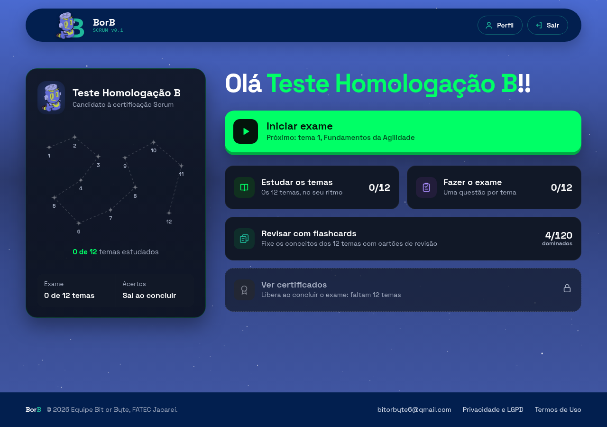 | 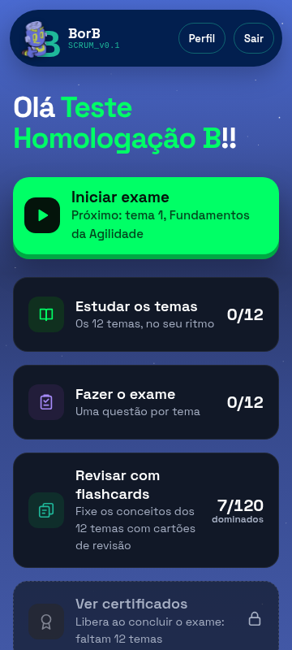 |

### Seleção de modo e temas

| Desktop (1280 px) | Celular (360 px) |
| --- | --- |
| 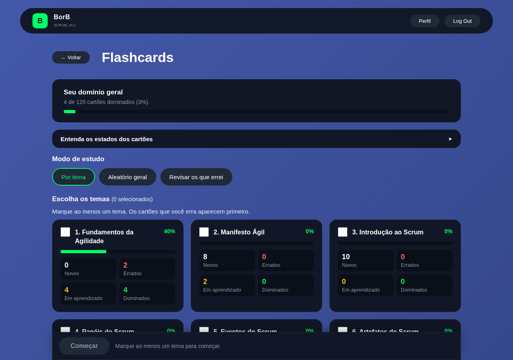 | 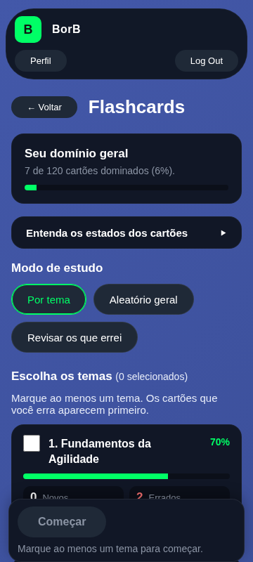 |

### Seleção com a legenda dos estados aberta

| Desktop (1280 px) | Celular (360 px) |
| --- | --- |
| 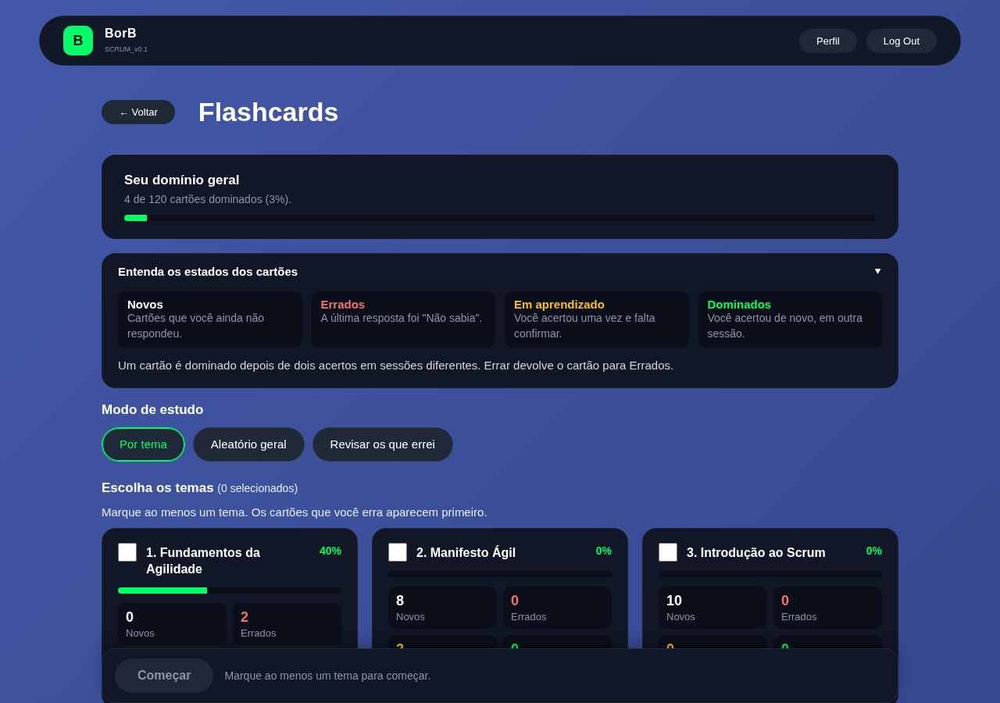 | 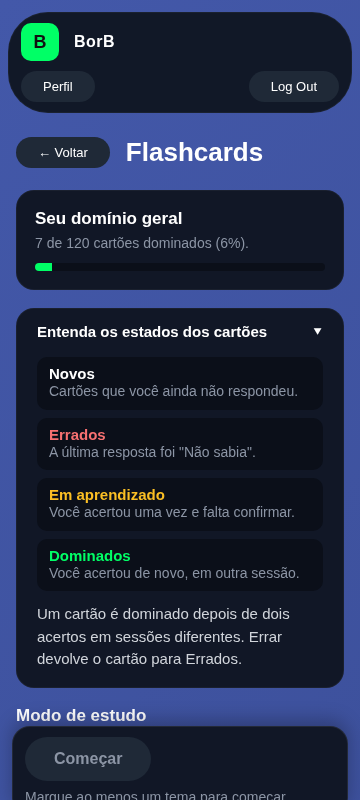 |

### Sessão: frente do cartão

| Desktop (1280 px) | Celular (360 px) |
| --- | --- |
| 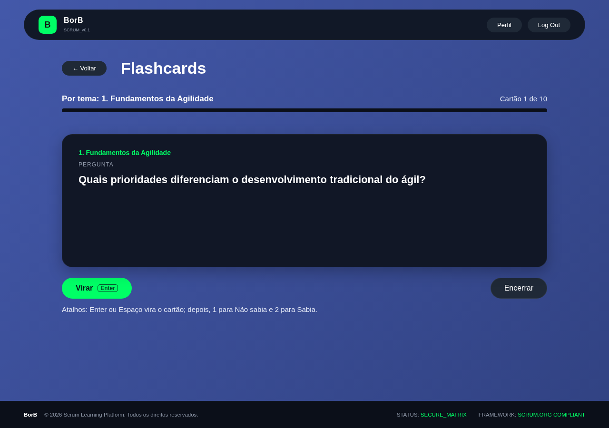 | 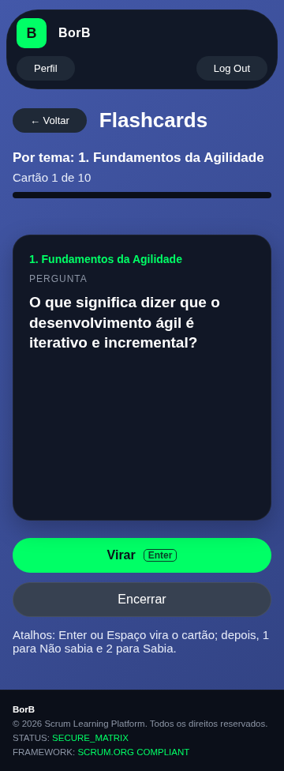 |

### Sessão: verso do cartão

| Desktop (1280 px) | Celular (360 px) |
| --- | --- |
| 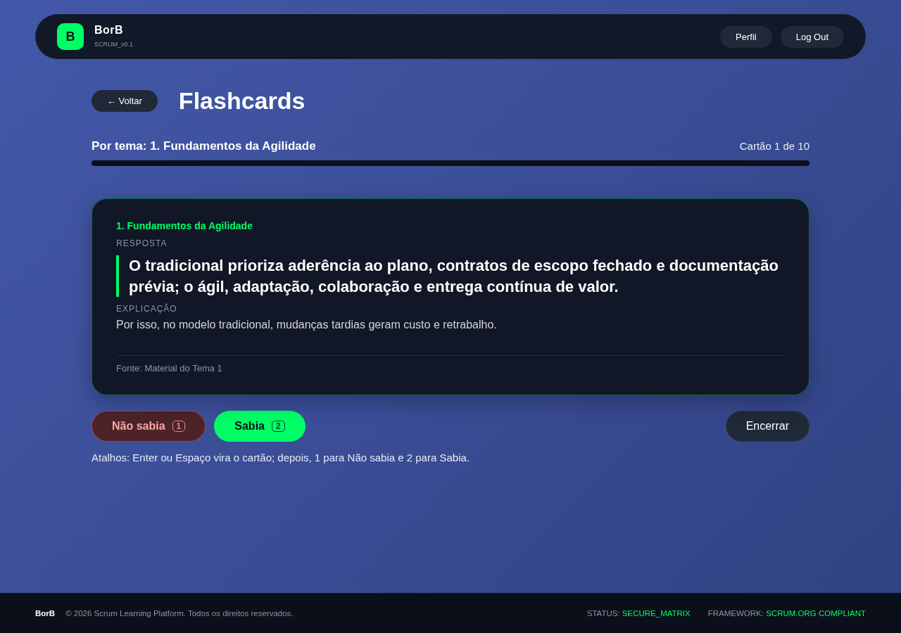 | 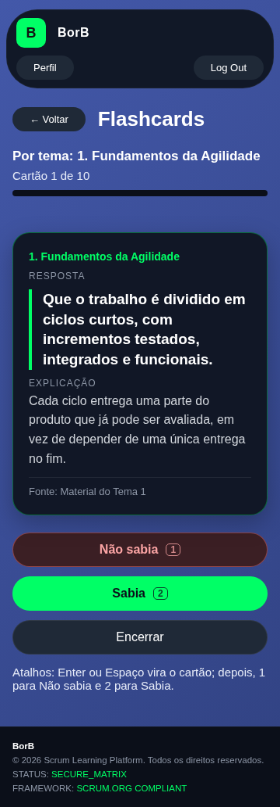 |

### Sessão: mudança de estado depois de responder

| Desktop (1280 px) | Celular (360 px) |
| --- | --- |
| 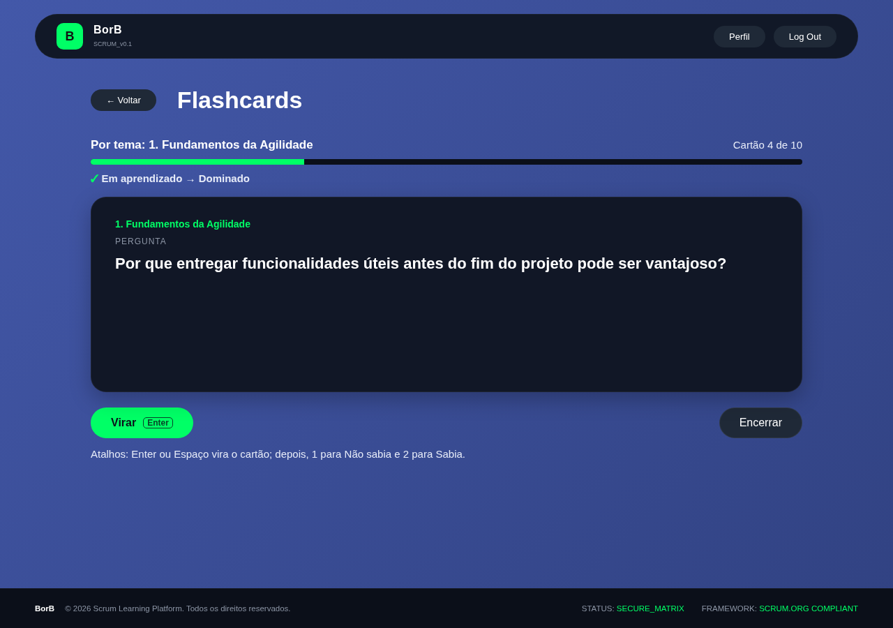 | 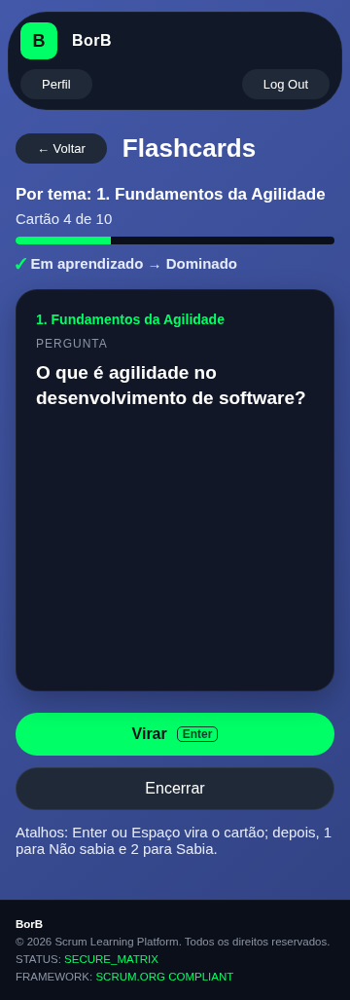 |

### Resumo da sessão

| Desktop (1280 px) | Celular (360 px) |
| --- | --- |
| 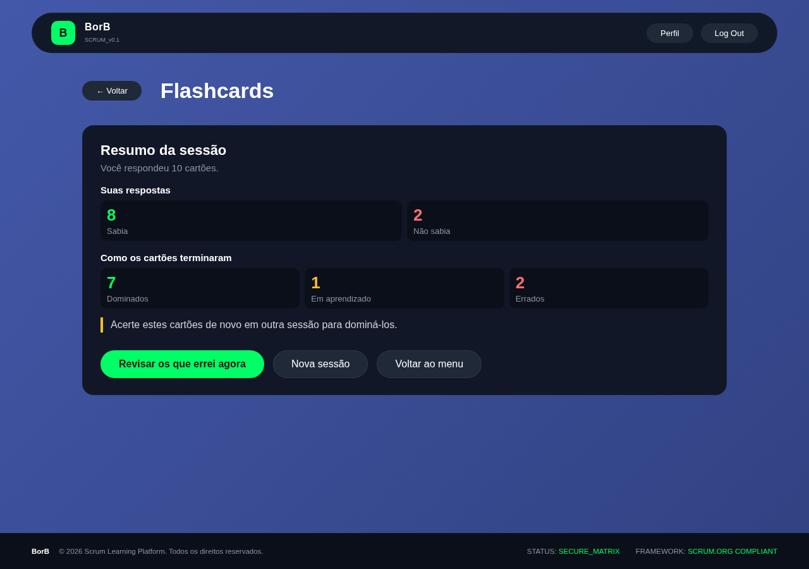 | 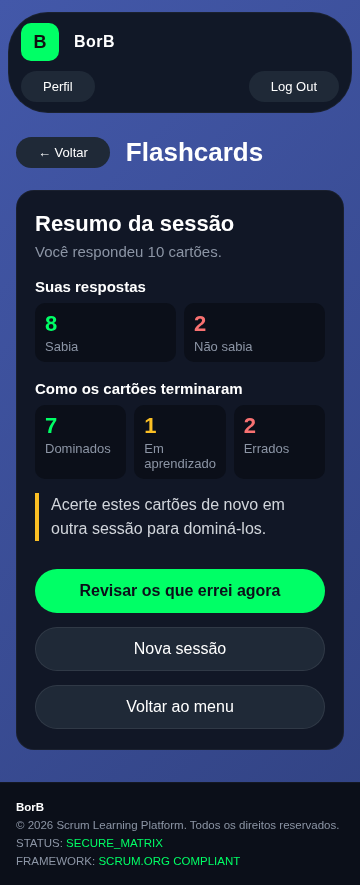 |
